pyR2D2 を使うための環境設定
===============================

pyR2D2 を使うための Python の環境と、計算の一覧を Google スプレッドシートに送るための設定を説明する。
pyR2D2 そのもののインストールは :doc:`pyr2d2` にある。
R2D2 (Fortran) を計算するためのコンパイラ・MPI・FFTW の準備は
`R2D2 マニュアル <https://hottahd.github.io/R2D2-manual/>`_ にある。

Pythonコードの環境設定
----------------------------------------
各自の方法でpythonをインストールすれば良いが、ここではminiforgeを用いる方法を説明する。
miniforgeをインストールし、以下に示すモジュール群をインストールする。
MacとLinuxで共通する部分が多いのでまとめて説明を記す。

詳しくは
`miniforgeのGitHubレポジトリ <https://github.com/conda-forge/miniforge>`_ を参照する。以下のコマンドでインストーラーをダウンロードする。

- Mac
    .. code:: shell

        curl -L -O "https://github.com/conda-forge/miniforge/releases/latest/download/Miniforge3-$(uname)-$(uname -m).sh"

- Linux
    .. code::

        wget "https://github.com/conda-forge/miniforge/releases/latest/download/Miniforge3-$(uname)-$(uname -m).sh"

    インストールするディレクトリは :code:`/home_directory/miniforge3` とする(デフォルト)。  インストール後、シェルの初期化ファイルに以下の行を追加して、miniforgeのbinディレクトリにPATHを通す。conda環境は重いので、必要なときにのみPATHを通すことを推奨する。
    スパコンのログインノードなどでもインストール方法は共通である。

ipythonの初期設定
~~~~~~~~~~~~~~~~~~~~~~~~~~~~~~~~~~~~~~~~
以下は必須ではないが、ipythonを使う時の初期設定ファイルである。
:code:`~/.ipython/profile_default/startup/00_first.py`
というファイルを作りそこに以下のように記す。

.. code:: python

    import sys, os
    import matplotlib.pyplot as plt
    import numpy as np
    from matplotlib.pyplot import pcolormesh,plot,clf,close
    from numpy import sin,cos,tan,arcsin,arccos,arctan,exp,log,log2,log10,mod,sqrt,absolute,sinh,cosh,tanh,pi,arange
    plt.ion()
    from IPython.core.magic import register_line_magic
    @register_line_magic
    def r(line):
    get_ipython().run_line_magic('run', ' -i ' + line)
    del r                                                                              
                                      
                                  
最後に記した設定によって、

.. code::

    r (Pythonスクリプト名)

とするだけで、スクリプトを実行できるようになる。

Googleスプレッドシート利用
~~~~~~~~~~~~~~~~~~~~~~~~~~~~~~~~~~~~~~~~

計算設定などをGoogleスプレッドシートにまとめておくと便利である。
R2D2では、Pythonから直接Googleスプレッドシートに送信する方法を提供しているので、利用したい方は検討されたい。

手順については、 `こちら <https://qiita.com/akabei/items/0eac37cb852ad476c6b9>`_ を参考にしたが、少し手順が違うのでこのページでも解説する。

まずは関連するモジュールのインストール。

.. code:: shell

    pip install gspread
    pip install google-auth

プロキシなどの影響でpipが使えない時は以下のようにする

gspreadのインストール

.. code:: shell

    git clone git@github.com:burnash/gspread.git
    cd gspread
    ipython setup.py install

oauth2clientのインストール

.. code:: shell

    git clone git@github.com:googleapis/oauth2client.git
    cd oauth2client
    ipython setup.py install

プロジェクト作成
||||||||||||||||||||||||||||||

ウェブブラウザで https://console.developers.google.com/cloud-resource-manager?pli=1 にアクセス。

「プロジェクトを作成」として、プロジェクトを作成

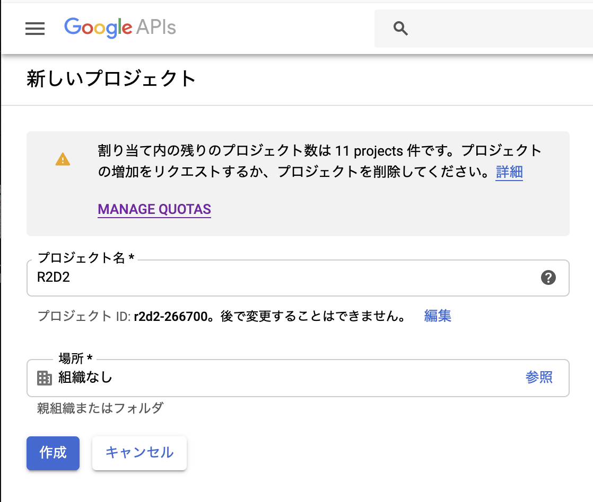

プロジェクト名はR2D2, 場所は組織なしとする。

API有効化
||||||||||||||||||||||||||||||

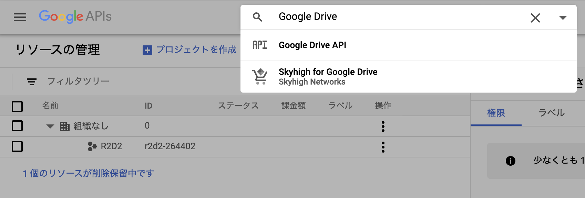

次に検索窓にGoogle Driveと打ち込んで、Google DriveのAPIを検索

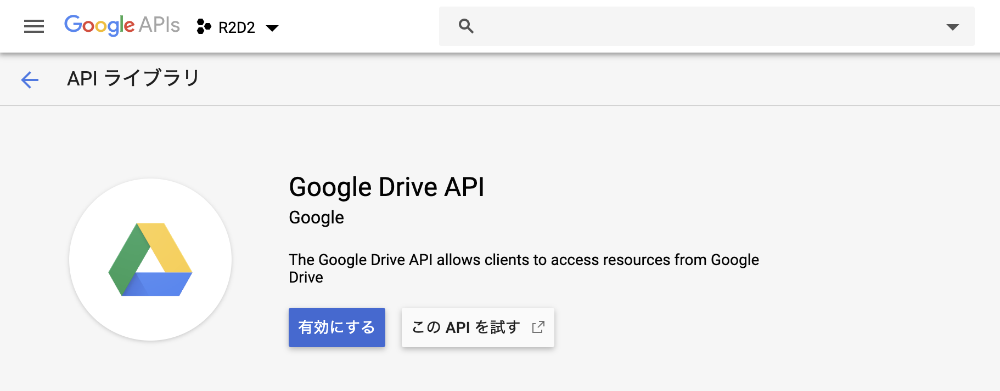

Google Drive APIを有効にする。

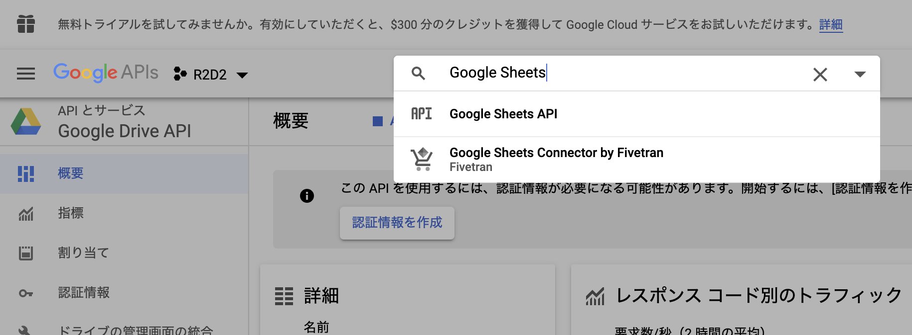

同様にGoogle Sheetsと検索

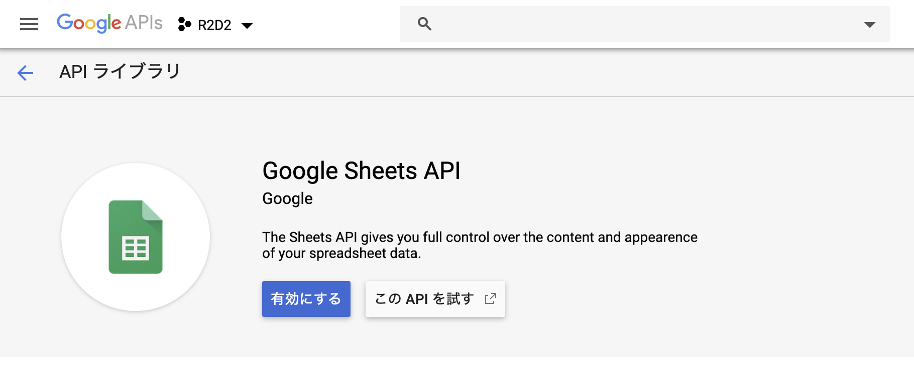

Google Sheets APIを有効化

サービスアカウント作成
||||||||||||||||||||||||||||||

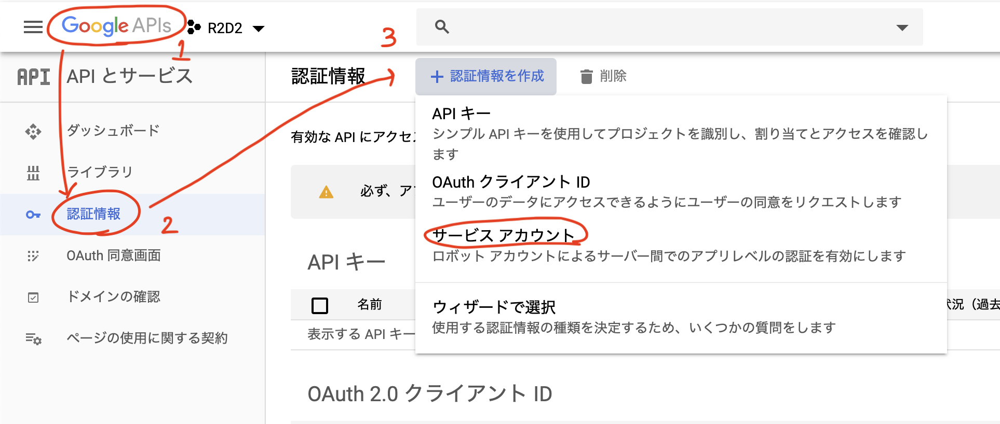

Google APIロゴ → 認証情報 → サービスアカウントとたどる。

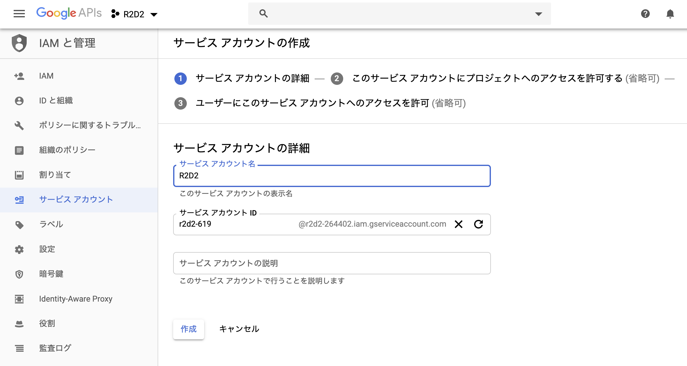

サービスアカウント名はR2D2とする

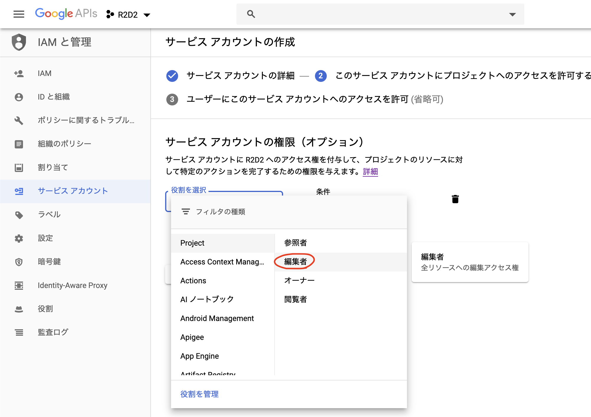

役割は編集者を選択

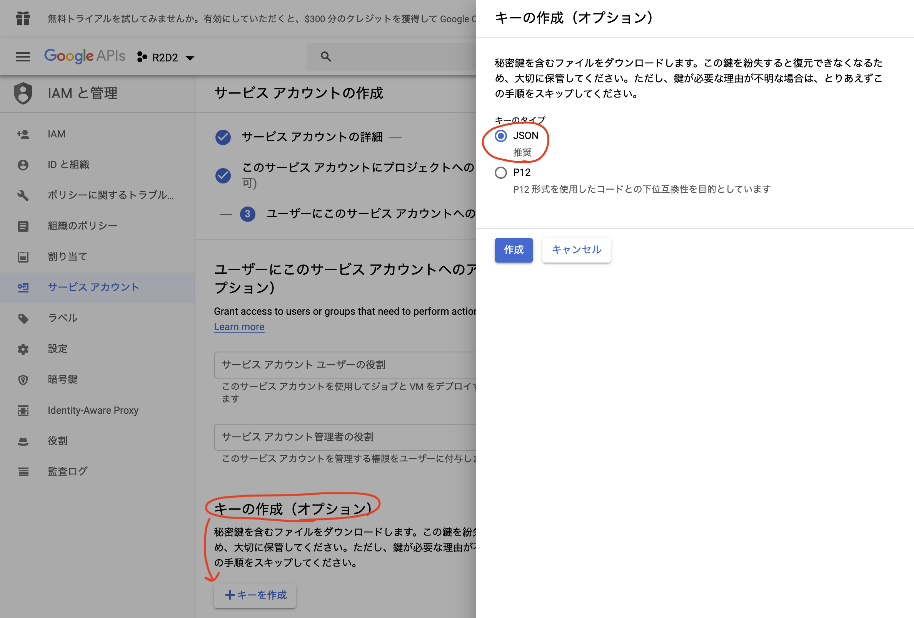

キーの生成ではJSONを選択し、キーを生成する。
ダウンロードしたファイルは、使用する計算機のホームディレクトリにjsonというディレクトリを作成し、その下に配置する。そのディレクトリには、このjsonファイル以外には何も置かないこと。

スプレッドシート作成
||||||||||||||||||||||||||||||

以下のウェブサイトからGoogleスプレッドシートを作成
https://docs.google.com/spreadsheets/create

名前はプロジェクト名とする。R2D2では、pyディレクトリの上のディレクトリ名を読みそれをスプレッドシートの名前として情報を送るので、ディレクトリと同じ名前にする。

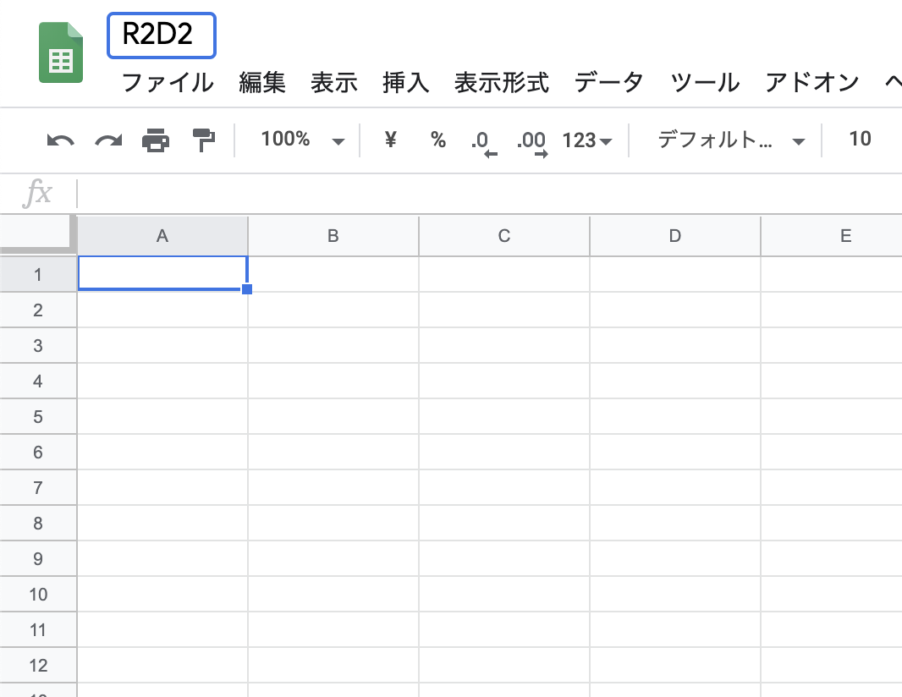

講習会ではR2D2としておく。

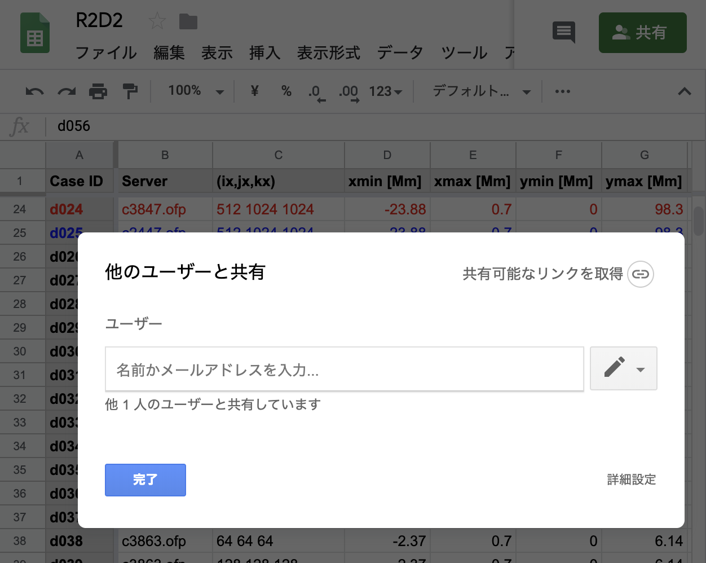

共有をクリックし、ダウンロードしたjsonファイルの中のclient_email行のEメールアドレスをコピーして、貼り付け。ここまでで、R2D2からGoogleスプレッドシートにアクセスできるようになる。

台帳の送信 (r2d2plus-ledger)
||||||||||||||||||||||||||||||

pyR2D2 を入れると、プロジェクトの全ラン (``<project>/run/dNNN``) の設定と状態を、データを読み込まずに
シートへ送るコマンド ``r2d2plus-ledger`` が入る。``push``・``pull`` にだけ ``gspread`` と ``google-auth`` が要る
(``pip install "pyR2D2[ledger]"``)。計算ノードでは動かさず、ログインノードか手元で使う。

.. code:: shell

    r2d2plus-ledger status ~/work/proj/run            # 各ランの状態と未送信 (UNSENT) の有無 (送らない)
    r2d2plus-ledger export ~/work/proj/run -o ledger.csv
    r2d2plus-ledger push   ~/work/proj/run --dry-run  # 書くセルを表示するだけ (Google に接続しない)
    r2d2plus-ledger push   ~/work/proj/run            # シート名 = プロジェクト名 (proj)
    r2d2plus-ledger pull   ~/work/proj/run            # シートで書き換えた目的などを 1 つずつ y/n で手元へ戻す
    r2d2plus-ledger --help                            # 使い方 (サブコマンドごとにも --help がある)

- 表示・警告・エラーは英語で出る。端末に出すときだけ色を付け (緑 = 正常、黄 = 注意、赤 = 失敗)、
  環境変数 ``NO_COLOR`` があれば付けない。シートの見出しと値 (``状態``・``保存`` など) は日本語のままである。
- 書くのはコードが管理する列のセルだけで、それ以外の列 (Note など) は人の列として読みも書きもしない。
- 送ると各ランの ``data/param/ledger_sent.toml`` に記録が残る。``pyR2D2.Data`` でそのランを開いたとき、
  未送信の変更があれば ``the ledger has unsent changes: r2d2plus-ledger push …`` と 1 行出る (R2D2plus のランだけ)。
- 列・単位・``pull`` で戻す項目などの決まりは R2D2plus の文書 (``docs/manual/run_ledger.rst``、非公開) にある。

最終更新日：|today|
